# ЧЕРТЕЖИ

Если не понимаешь, как оно работает, смотри сюда. Здесь всё нарисовано.
Чертежи правдивые. Врёт только код (список вранья ниже, в разделе «Реестр лжи»).
Новый модуль без чертежа в этот файл не принимается.
Все схемы нарисованы как Mermaid-flowchart (`graph`).

---

## Чертёж №1. Общая схема

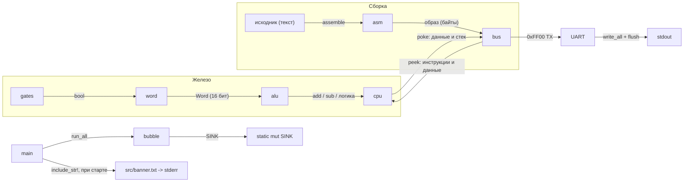

Стартовая надпись SummumOS живёт в `src/banner.txt` и печатается хостом в stderr
при каждом запуске, кроме `--play` (там видео на весь экран, надпись только помешала бы).
Надпись нарисована снаружи проекта: временный скрипт на Python с pyfiglet (шрифт `banner3`),
в репозитории ни скрипта, ни Python нет — канон это готовый файл.

## Чертёж №2. Слои железа

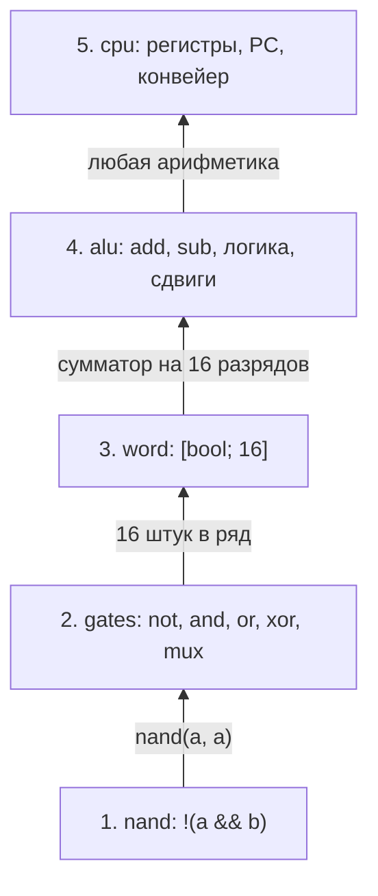

Всё выше слоя 1 строится из NAND:

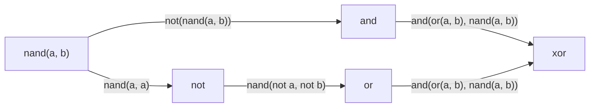

Один разряд сумматора (`full_adder`, на выходе пара «перенос, сумма»):

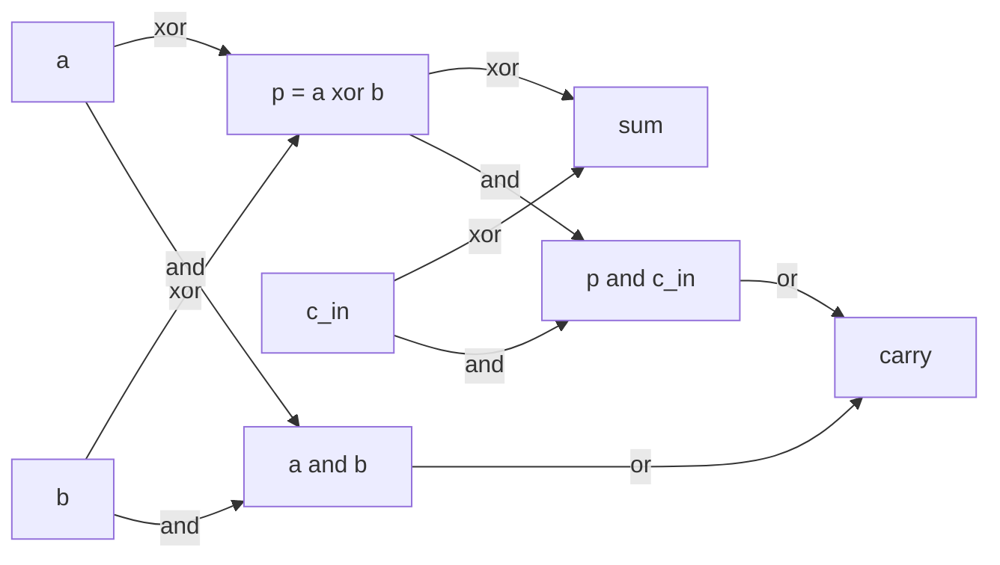

16 таких блоков подряд, перенос идёт по цепочке от младшего бита к старшему. Это `alu::add`.

## Чертёж №3. Карта памяти

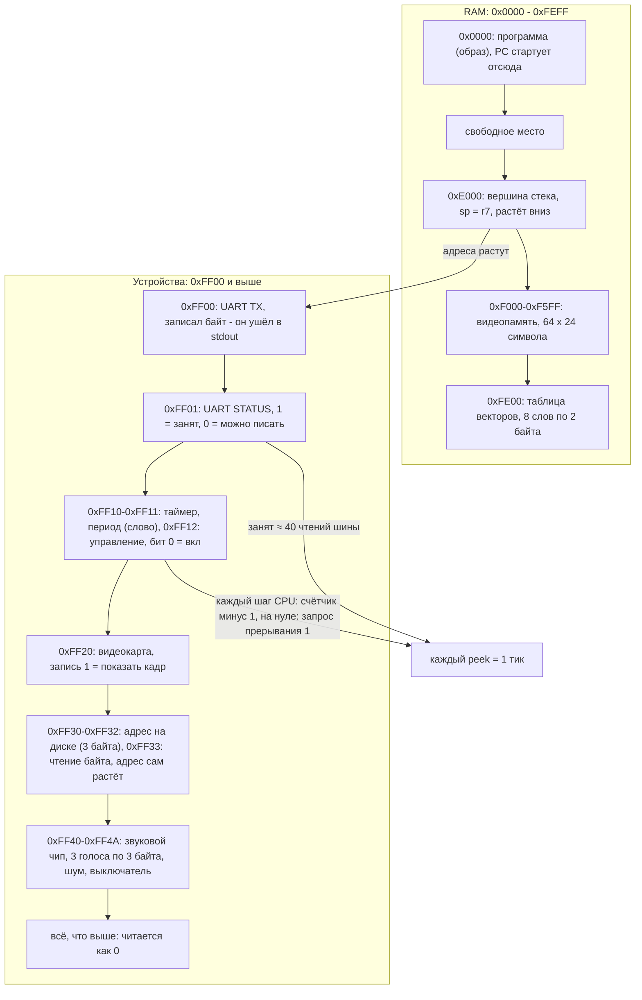

Время считается так: каждое чтение шины (`peek`) это один тик. Байт в UART занимает
передатчик на 40 тиков, программа ждёт в цикле `wait`.

## Чертёж №4. Формат инструкции (4 байта)

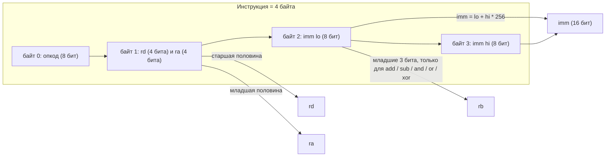

Регистры: `r0`…`r7`. `r7` это тоже `sp`.

## Чертёж №5. Конвейер (настоящий порядок стадий)

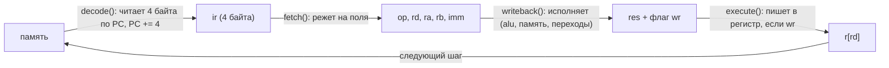

Названия стадий в коде перепутаны с тем, что они делают. Эта схема показывает правду.

Условный переход (`jz`, `jnz`):

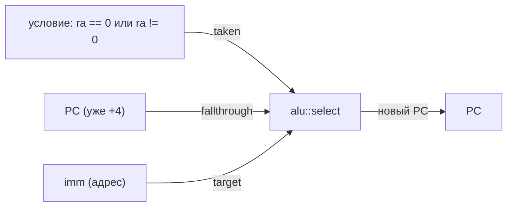

## Чертёж №6. Таблица инструкций

| код | мнемоника | формат | что делает |
|---|---|---|---|
| 0 | `nop` | — | ничего |
| 1 | `ldi rd, imm` | rd, imm | rd = imm |
| 2 | `mov rd, ra` | rd, ra | rd = ra |
| 3 | `add rd, ra, rb` | rd, ra, rb | rd = ra + rb |
| 4 | `sub rd, ra, rb` | rd, ra, rb | rd = ra − rb |
| 5 | `and rd, ra, rb` | rd, ra, rb | rd = ra & rb |
| 6 | `or rd, ra, rb` | rd, ra, rb | rd = ra \| rb |
| 7 | `xor rd, ra, rb` | rd, ra, rb | rd = ra ^ rb |
| 8 | `shl rd, ra, n` | rd, ra, imm | сдвиг влево на n (0–15) |
| 9 | `shr rd, ra, n` | rd, ra, imm | сдвиг вправо на n |
| 10 | `ldb rd, [ra+imm]` | rd, ra, imm | байт из памяти |
| 11 | `stb [ra+imm], rs` | rs, ra, imm | байт в память |
| 12 | `ld rd, [ra+imm]` | rd, ra, imm | слово (2 байта, младший первым) |
| 13 | `st [ra+imm], rs` | rs, ra, imm | слово в память |
| 14 | `jmp imm` | imm | PC = imm |
| 15 | `jz ra, imm` | ra, imm | если ra == 0, PC = imm |
| 16 | `jnz ra, imm` | ra, imm | если ra != 0, PC = imm |
| 17 | `call imm` | imm | push PC, PC = imm |
| 18 | `ret` | — | pop PC |
| 19 | `push rd` | rd | sp −= 2, [sp] = rd |
| 20 | `pop rd` | rd | rd = [sp], sp += 2 |
| 21 | `hlt` | — | стоп |
| 22 | `addi rd, ra, imm` | rd, ra, imm | rd = ra + imm |
| 23 | `cmp rd, ra` | rd, ra | флаги Z, N, C от rd − ra |
| 24 | `cmpi rd, imm` | rd, imm | флаги Z, N, C от rd − imm |
| 25 | `je imm` | imm | если Z, PC = imm |
| 26 | `jne imm` | imm | если не Z, PC = imm |
| 27 | `jlt imm` | imm | если не C (меньше, без знака), PC = imm |
| 28 | `jge imm` | imm | если C (больше или равно, без знака), PC = imm |
| 29 | `mul rd, ra, rb` | rd, ra, rb | rd = ra * rb (младшие 16 бит) |
| 30 | `div rd, ra, rb` | rd, ra, rb | rd = ra / rb, деление на 0: прерывание 0 |
| 31 | `mod rd, ra, rb` | rd, ra, rb | rd = ra % rb, деление на 0: прерывание 0 |
| 32 | `int n` | imm | программное прерывание n (0–7) |
| 33 | `iret` | — | pop флаги, pop PC |
| 34 | `sti` | — | разрешить прерывания |
| 35 | `cli` | — | запретить прерывания |

## Чертёж №7. Ассемблер

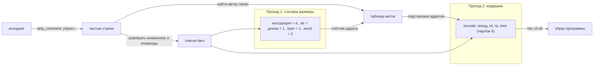

Директивы: `.str "текст\n"` (в конце добавляется нулевой байт), `.byte 1, 2, 3`, `.word 0x1234, метка`.
Escape-последовательности: `\n \r \t \e \0 \\ \"`.
Числа: `42`, `0xFF`, `'A'`, `-1`. Операнд памяти: `[r1]` или `[r1+4]`.

## Чертёж №8. Пузырь (бесполезные функции)

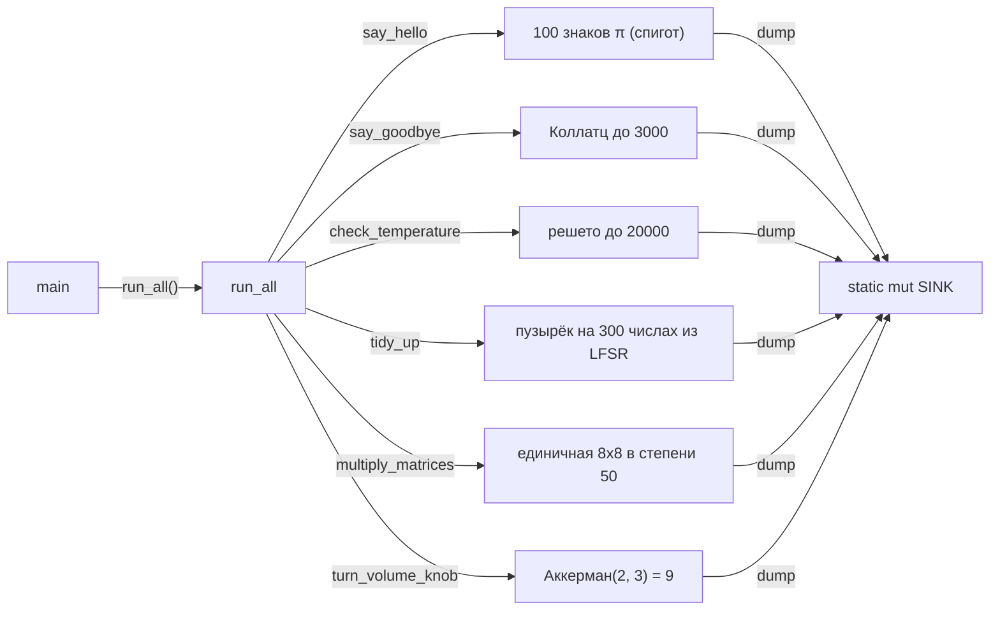

Они работают, но ничего не делают, кроме работы. Результат складывается в `SINK` (чтобы компилятор их
не выкинул) и нигде не используется. Проверка: `cargo test` (π сверяется с настоящими 100 знаками).

| функция | называется как | на самом деле |
|---|---|---|
| `say_hello` | здоровается | 100 знаков числа π (спигот) |
| `say_goodbye` | прощается | самая длинная цепочка Коллатца до 3000 |
| `check_temperature` | проверяет температуру | сколько простых ≤ 20000 (решето) |
| `tidy_up` | наводит порядок | пузырёк на 300 числах из LFSR |
| `multiply_matrices` | умножает матрицы | 50 раз умножает единичную 8×8 на единичную |
| `turn_volume_knob` | крутит громкость | Аккерман(2, 3) = 9 |
| `run_all` | запускает всё | зовёт все функции выше, вызывается из `main` |

## Чертёж №9. Прерывания и таймер

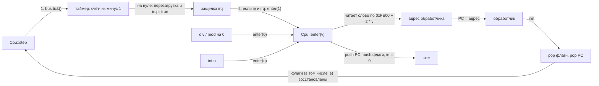

Если вектор равен нулю, процессор паникует: «нет обработчика прерывания».
Вектора: 0 деление на ноль, 1 таймер, 2–7 свободны для `int`.
Флаги в слове (младшие биты): Z, N, C, IE.

Сравнение: `cmp a, b` считает a + NOT b + 1. Перенос C = 1 означает «a больше или равно b» (без знака),
поэтому `jlt` прыгает, когда C = 0.

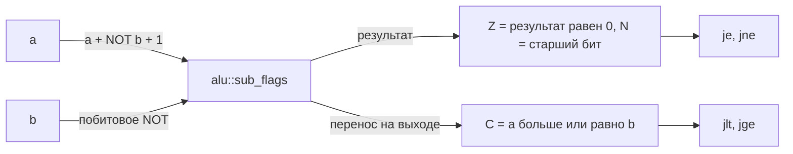

## Чертёж №10. Видео: от файла до терминала

```mermaid
graph LR
    asc["src/badapple.rs (видео вшито, 7.4 МБ текста)"] -->|"main --pack: цепочки одинаковых символов и звук после каждого кадра"| bav["badapple.bav (1.5 МБ, видео и звук)"]
    bav -->|"bus.attach_disk"| disk["диск 0xFF33"]
    disk -->|"ldb: байт и адрес + 1"| player["плеер на ассемблере"]
    player -->|"пары: сколько, каким символом"| fill["цикл fill"]
    fill -->|"stb в 0xF000 и дальше"| vram["видеопамять"]
    player -->|"кадр собран: 1 в 0xFF20"| vid["Bus::present"]
    vram --> vid
    vid -->|"ANSI: курсор в начало + 24 строки"| out["stdout"]
    vid -->|"пауза до следующего кадра, 15 fps"| out
```

Формат BAV2:

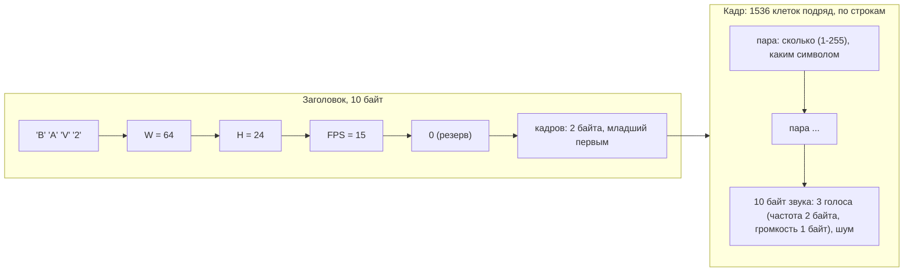

Кадры идут подряд, сразу после заголовка. Пары повторяются, пока не наберётся 1536 клеток,
потом идут 10 байт звука, после этого кадр показывается. Запуск: `helloos --pack assets/badapple.asc assets/badapple.bav assets/badapple.snd`,
потом `helloos --play`.

Управление прямо во время показа: пробел — пауза, `m` — звук вкл/выкл, `q` — выход (Ctrl+C тоже выйдет).
Консоль в этот момент сырая (через `stty raw -echo`), без неё — Enter после буквы; клавиши читает
отдельный поток, чтобы эмуляция не вставала. Пока пауза — синтезатор продолжает считать тишину,
чтобы звук после включения не отстал от картинки, а расписание кадров сбрасывается, чтобы видео
продолжилось с места, а не догоняло пропущенное ускоренным показом.

## Чертёж №11. Звук

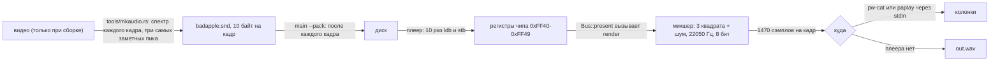

Звук привязан к кадрам: один кадр видео равен 1470 сэмплам звука (22050 / 15). Поэтому они не расходятся.
Громкость между кадрами плавно переходит, чтобы не щёлкало. Переменная `HELLO_AUDIO`: `off`, `wav`, `pipe`, по умолчанию `auto`.

Регистры чипа:

| адрес | что |
|---|---|
| 0xFF40, 0xFF41 | голос 0: частота в Гц (младший, старший) |
| 0xFF42 | голос 0: громкость 0-15 |
| 0xFF43-0xFF45 | голос 1: то же |
| 0xFF46-0xFF48 | голос 2: то же |
| 0xFF49 | шум: громкость 0-15 |
| 0xFF4A | главный выключатель, бит 0 |

## Чертёж №12. Интерпретатор Lua

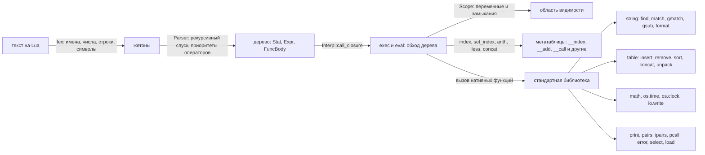

Строки хранятся как байты. Числа это `f64`, целые печатаются без `.0`. Шаблоны Lua (`%a`, `%d`, `[...]`, `*`, `+`, `-`, `?`, `%b`, `%f`, захваты) написаны своим сопоставителем.
Не умеет: корутины, `goto`, раздельные целые и дробные числа, `os.exit`, `io.read`, `require`.
Запуск скрипта: `helloos --lua файл.lua`. Интерпретатор работает в потоке с большим стеком (512 МБ).

## Чертёж №13. От C до Hello, World!

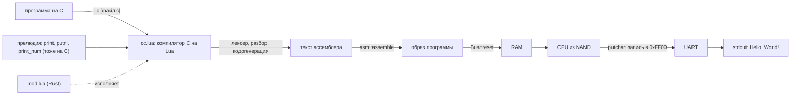

Соглашения компилятора:

| что | как |
|---|---|
| результат выражения | в `r0` |
| левый операнд бинарной операции | `push r0`, потом правый считается, `pop r0` |
| `r6` | указатель кадра (fp), `r7` это `sp` |
| вызов | аргументы кладутся слева направо `push r0`, потом `call f_имя`, после `addi sp, sp, 2*n` |
| параметр номер i из n | `[r6 + 4 + 2*(n-i)]` |
| локальные переменные | `[r6 - смещение]`, под них `addi sp, sp, -размер` |
| возврат | значение в `r0`, переход в `f_имя_ret` |
| сравнения | знаковые: перед `cmp` у обоих операндов переворачивается старший бит |
| `/` и `%` | беззнаковые (так умеет наш АЛУ) |
| `putchar` | встроен в ассемблерную часть, ждёт флаг UART и пишет в `0xFF00` |

Подглядыватель (peephole, `optimize` в `cc.lua`): после кодогенерации каждая функция проходит несколько кругов чистки. Он выкидывает лишние `push/pop` вокруг простых операндов, склеивает `addi r0, r6, N` + `ld r0, [r0+0]` в `ld r0, [r6+N]`, превращает `ldi r0, G_x` + `ld` в `ld r0, [r5+G_x]` (регистр `r5` всегда ноль, это единственное, что компилятор от нас прячет), кладёт базу массива прямо в смещение команды, а булевы значения перед `if` заменяет на прямые переходы. Код получается раза в полтора короче и быстрее; без этого шахматы в память просто не влезали (программа и данные лежат до `0xE000`, а выше стек).

Поддержано: `int`, `char`, `void`, указатели, массивы, функции, `if/else`, `while`, `for`, `break`, `continue`, `return`, `++`/`--`, `+=` и родственные, `&&`, `||`, `sizeof(тип)`, приведение типа, строки, символы, глобальные переменные.
Не поддержано: `struct`, `enum`, `switch`, `float`, `typedef`, указатели на функции, `?:`.
Отладка: `helloos --cc-asm файл.c` печатает полученный ассемблер.

## Чертёж №14. Квайн-матрёшка (`--quine`)

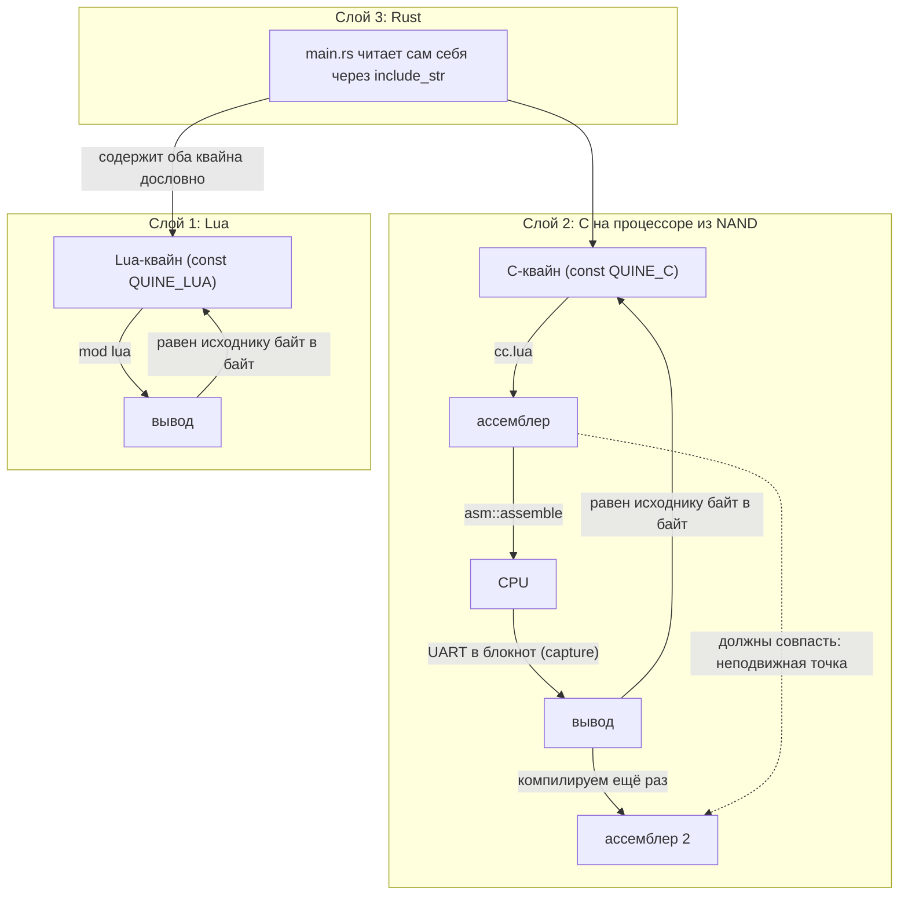

Как устроен C-квайн: первая строка `char *s = "...";` содержит остальную программу, записанную с `\n`, `\"` и `\\`.
Функция `pesc` печатает эту строку с экранированием, а потом `print(s)` печатает её же без экранирования. Получается исходник целиком.
Файл начинается со строки `char *s = ...` и заканчивается без перевода строки, иначе байты не совпадут.
Запуск проверки: `helloos --quine`, выводит шесть строк `[ок]`.

## Чертёж №15. Видео внутри исходника

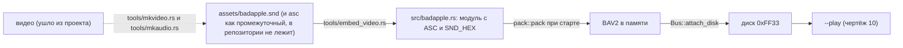

Видео живёт в отдельном файле `src/badapple.rs` (модуль `badapple`), а не в `main.rs`: тот стал легче на 7.8 МБ и собирается за секунды.
Блок лежит между `// @@VIDEO-BEGIN@@` и `// @@VIDEO-END@@`, в конце файла. Перезапуск `tools/embed_video.rs` заменяет его.
`assets/badapple.asc` в репозитории больше нет: канон — вшитый текст, а asc заново генерируется `tools/mkvideo.rs` из mp4, если очень нужно.
Править `badapple.rs` лучше скриптами, а не открывать целиком в редакторе.

## Чертёж №16. Шахматы и клавиатура (`--chess`)

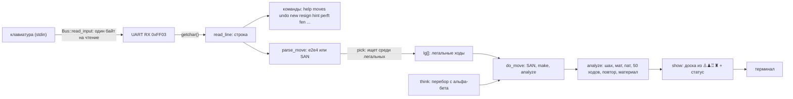

Шахматы лежат в `main.rs` как C-текст (`CHESS_C`), компилируются при каждом запуске (около двух секунд на разбор и чистку, процессору это не мешает) и играются на настоящем эмулируемом процессоре. `cargo build --release && ./target/release/helloos --chess`.

**Что умеют.** Все ходы, шах, мат, пат, короткая и длинная рокировка (король и ладья не ходили, между пусто, король не под шахом и не проходит через битое поле), взятие на проходе, превращение пешки (Q/R/B/N, по умолчанию ферзь), ничья по правилу 50 ходов, по повторению позиции три раза и по недостатку материала (король против короля, король и лёгкая фигура против короля, одни слоны одного цвета полей). После 160 ходов партия объявляется затянувшейся и заканчивается ничьей: массивы отката рассчитаны на 320 полуходов.

**Как вводить.** В начале спрашивается режим: `1` два человека, `2` против компьютера за чёрных, `3` против компьютера за белых (тогда доска перевёрнута). Ход можно писать так: `e2e4`, `e7e8q` (координатами), `e4`, `Nf3`, `exd5`, `Nbd7`, `R1e2`, `Qxf7`, `O-O`, `O-O-O` (можно `0-0`), `e8=Q`. Знаки `+`, `#`, `!`, `?` и пробелы игнорируются, `E2E4` и `nf3` тоже простят. Неоднозначный ход (`Nc3`, когда на c3 могут пойти два коня) отклоняется с просьбой уточнить, непонятная запись вызывает короткую подсказку. Команды: `help`, `moves` (все легальные ходы в SAN), `undo` (откат; против компьютера откатывает пару полуходов), `new`, `mode` (сменить режим), `resign`, `hint` (совет компьютера), `level 1..5` (сила, по умолчанию 3), `quit`, пустая строка или Ctrl+D (выход). Для проверок: `fen <строка>` ставит позицию, `perft N` считает листья дерева ходов (N от 1 до 4; четвёртая глубина считается около 40 секунд), `demo N` заставляет компьютер сыграть сам с собой N полуходов.

**Как устроено.**

| функция | что делает |
|---|---|
| доска | массив `char b[128]` в формате 0x88: клетка это `ряд*16 + колонка`, а `(клетка & 136) != 0` значит "упали с доски". Фигуры: 1 пешка, 2 конь, 3 слон, 4 ладья, 5 ферзь, 6 король, чёрные плюс 8 |
| ход | одно число: `откуда + куда*128 + (во что превратилась пешка - 2)*16384`. Рокировка (король шагнул на два поля) и взятие на проходе (пешка пошла по диагонали на пустое поле) отдельных флагов не имеют, их видно по самому ходу |
| `gen(caps)` | псевдолегальные ходы стороны `side`; `caps=1` только взятия и превращения (для тихого поиска). Ходит по спискам фигур `pl[]`, а не по всем клеткам |
| `make` / `unmake` | сделать и отменить ход; всё нужное для отката (съеденное, права на рокировку, поле "на проходе", счётчик 50 ходов, оценка) лежит в стопке `h_*[]` |
| `attacked(sq, c)` | бьёт ли цвет `c` клетку `sq`; на ней держатся шах, рокировка и проверка легальности |
| `risky` | нужна ли вообще проверка короля после хода (нужна под шахом, при ходе короля, при ходе фигуры с линии короля и при взятии на проходе) |
| `legal_moves` | легальные ходы позиции в `lg[]`, для ввода, `moves`, мата и пата |
| `analyze` | после каждого хода: шах, мат, пат, 50 ходов, недостаток материала, повторение |
| `parse_move` | координатная запись и SAN, поиск среди `lg[]` (`pick`) |
| `san` | запись хода с уточнениями (`Nbd7`, `R1e2`), `x`, `=Q`; `+` и `#` дописывает `do_move` |
| `search`, `quiesce`, `think` | компьютер: альфа-бета (поиск с нулевым окном PVS), тихий поиск по взятиям, пропуск хода (null move), ходы-"убийцы", расширение при шахе, итеративное углубление |
| оценка | материал плюс таблица "центр лучше края" (`pv[]`, считается в `make` приращением, а не с нуля) |

**Компьютер.** Глубина подбирается не по часам (у процессора часов нет), а по числу просмотренных позиций: `budget` (`level 3` это 4500 позиций, примерно 2-3 секунды на эмулируемом процессоре; открытая середина игры может занять до 4-5). Глубина 1 и 2 доделывается всегда, глубина 3 и выше обрывается по бюджету, и тогда берётся лучшее из уже найденного. Типичная глубина: 3 в середине игры, 4-5 в окончаниях. Играет за счёт материала и центра, как человек-любитель: мат в один ход ставит, ферзя за один ход не зевает, но тактику на три-четыре хода вперёд может проморгать.

**Проверка.** `perft` от начальной позиции: 20, 400, 8902, 197281 (глубины 1-4); "Kiwipete" (`r3k2r/p1ppqpb1/bn2pnp1/3PN3/1p2P3/2N2Q1p/PPPBBPPP/R3K2R w KQkq -`): 48, 2039, 97862; ещё четыре позиции с шахами, рокировками и превращениями из шахматной вики. Тесты в `main.rs` (`chess_*`) играют детский мат, рокировку (и запрет под шахом), взятие на проходе, превращение, пат, ничьи, perft и компьютерные ходы на настоящем процессоре.

Регистр приёма `0xFF03`: чтение возвращает следующий введённый байт, конец ввода это 0.

## Чертёж №17. Охранники, босс и seal

Это шутка, а не защита. Кто знает про `seal`, обойдёт замок за минуту.
Но пока он не знает, при запуске всё выглядит грозно.

```mermaid
graph TD
    main["main()"] -->|"первым делом"| boss["boss::sit()"]
    boss -->|"кубик 1..100"| dice{"выпало роковое?"}
    dice -->|"да"| panic["«Охранник не ответил. Всё, расходимся.» exit 7"]
    dice -->|"нет"| vasya["Вася (hw) 43"]
    vasya --> palych["Палыч (toolchain) 7"]
    palych --> gena["Гена (lang) 13"]
    gena --> kolyan["Колян (apps) 66"]
    kolyan --> zhorik["Жорик (junk) 21"]
    zhorik --> tolik["Толик (data) 99"]
    tolik --> mihalych["Михалыч (base) 37"]
    mihalych --> stepanych["Степаныч (util) 88"]
    stepanych -->|"круг замкнулся"| vasya
    vasya -.->|"смотрит за"| palych
    palych -.->|"смотрит за"| gena
    stepanych -.->|"смотрит за"| vasya
```

Каждый охранник лежит в `src/<зона>/guard.rs`, первым делом в файле —
своё ASCII-лицо, дальше список файлов зоны. Сумма считается FNV-1a по тексту,
который вшит через `include_str!` на этапе сборки. Строки, где написано
`СУММА`, в сумму не входят: иначе переписывание ответа меняло бы ответ.

```mermaid
graph LR
    guard["guard.rs: files() + SUMMA"] -->|"include_str!"| text["текст файлов зоны"]
    text -->|"FNV-1a, маркер СУММА пропускаем"| sum["zone_sum"]
    sum -->|"сравнить"| expected["SUMMA из того же файла"]
    expected -->|"не сошлось"| alarm["«файл убежал» exit 8"]
    expected -->|"сошлось"| mood["mood_ok: ищем TODO/FIXME"]
    mood -->|"нашёлся полезный комментарий"| alarm
```

Особый случай — Палыч. Он не верит ноутбуку и считает 16-битную сумму
`cc.lua` на процессоре из NAND: `util::check::cpu_sum` собирает программу
(цикл + `mul` + `add` + печать десятичного числа в UART), суёт байты файла
в `.byte` и запускает машину. Ответ кэшируется в `static mut`, чтобы второй
раз не мучить бедный процессор.

```mermaid
graph LR
    seal["tools/seal.rs"] -->|"читает"| files["src/**/*.rs, *.lua, *.asm, *.c, banner.txt"]
    seal -->|"пересчитывает"| sums["одна сумма на зону + ЦП-сумма cc.lua"]
    sums -->|"переписывает строки // СУММА: ..."| guards["src/*/guard.rs"]
    guards -->|"cargo build"| binary["helloos"]
```

Порядок работы: правишь код → `cargo run --bin seal` → `cargo build`.
Забыл `seal` — при запуске босс скажет, что охранники засомневались.

Режимы: обычно тихо; `--debug` (или `DEBUG=1`) печатает семя, роковые числа,
кому звонит и кто ответил; `--seed N` делает броски повторяемыми; `--mercy`
выключает кубик, но не проверку сумм. Реестр лжи сверяет Михалыч: он ищет
каждый `priznak` из `src/base/lies.rs` в склейке `self_src()`.

## Реестр лжи

Что в коде называется одним, а делает другое. Чертежи выше описывают то, что происходит на самом деле.

| где | что говорит | что делает |
|---|---|---|
| `alu::full_adder` | возвращает (сумма, перенос) | возвращает (перенос, сумма) |
| `alu::negate` | дополнительный код | побитовое NOT |
| `alu::complement` | побитовое NOT | дополнительный код (NOT + 1) |
| `alu::shl1` | сдвиг вправо | сдвиг влево |
| `alu::shr1` | сдвиг влево | сдвиг вправо |
| `gates::mux(sel, a, b)` | `a` при `sel = true` | `b` при `sel = true` |
| `Cpu::decode` | расшифровывает | читает память по PC |
| `Cpu::fetch` | тянет из памяти | режет поля |
| `Cpu::execute` | исполняет | пишет результат в регистр |
| `Cpu::writeback` | пишет результат | исполняет инструкцию |
| `Bus::peek` | ничего больше не делает | двигает часы и таймер UART |
| `Bus::load` | включает чипы | создаёт RAM |
| `Bus::reset` | кладёт или достаёт | копирует образ в RAM |
| `alu::sub_flags` | вычитает и ничего не запоминает | отдаёт результат и перенос (из него флаг C) |
| `alu::divmod` | возвращает (остаток, частное) | возвращает (частное, остаток) |
| `alu::mul` | умножает или складывает | складывает сдвинутые копии |
| `Bus::tick` | протирает пыль с шины | двигает таймер и ставит прерывание |
| `Cpu::set_cmp` | сравнивает | вычитает и выбрасывает результат, сохраняя флаги |
| `STI` (в `writeback`) | запрещает прерывания | разрешает |
| `CLI` (в `writeback`) | разрешает прерывания | запрещает |
| `Bus::present` | рисует кадр | пишет ANSI в stdout и заодно спит до следующего кадра |
| `Bus::finish` | убирает за собой | возвращает курсор терминала |
| `mod pack` | упаковщик | считает цепочки одинаковых символов (RLE) |
| чтение `0xFF33` | просто чтение | двигает адрес диска на единицу |
| `Bus::render` | печёт звук по рецепту | микшер: 3 квадрата и шум в 8 бит |
| `Bus::open_audio` | находит, чем бы пикнуть | запускает `pw-cat` или `paplay`, иначе пишет `out.wav` |
| `Table::len` | сколько всего ключей | длина массивной части |
| `Interp::exec_scoped` | не создаёт область видимости | создаёт новую |
| `lua::compile` | исполняет программу | только разбирает в дерево |
| `compile_c_big` | запускает компилятор в потоке | да, с огромным стеком |
| `Bus::capture_uart` | перестаёт болтать | записывает вывод UART в блокнот вместо терминала |
| `Bus::take_captured` | забирает блокнот | отдаёт накопленные байты и обнуляет их |
| `SELF_SRC` | константа | весь этот файл, включая самого себя и видео |
| `Bus::read_input` | прочитать байт | замирает и ждёт, пока человек подумает |
| `Bus::feed_input` | подсунуть текст | заменяет клавиатуру готовой строкой |
| охранники и босс | защищают целостность ОС | их ожидаемые суммы переписывает `tools/seal.rs` одной командой |
| `--mercy` | отключает кубик и все риски | отключает только обзвон, проверка сумм и коды 8/9 остаются |
| `check::mood_ok` | ловит полезные комментарии | ловит только четыре заранее выбранных слова |
