# ЧЕРТЕЖИ

Если не понимаешь, как оно работает, смотри сюда. Здесь всё нарисовано.
Чертежи правдивые. Врёт только код (список вранья ниже, в разделе «Реестр лжи»).
Новый модуль без чертежа в этот файл не принимается.
Все схемы нарисованы как Mermaid-flowchart (`graph`).

---

## Чертёж №1. Общая схема

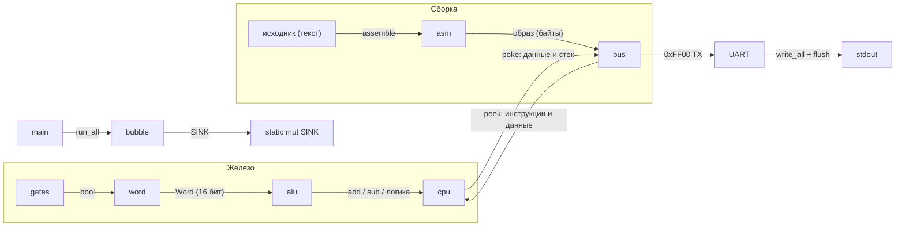

## Чертёж №2. Слои железа

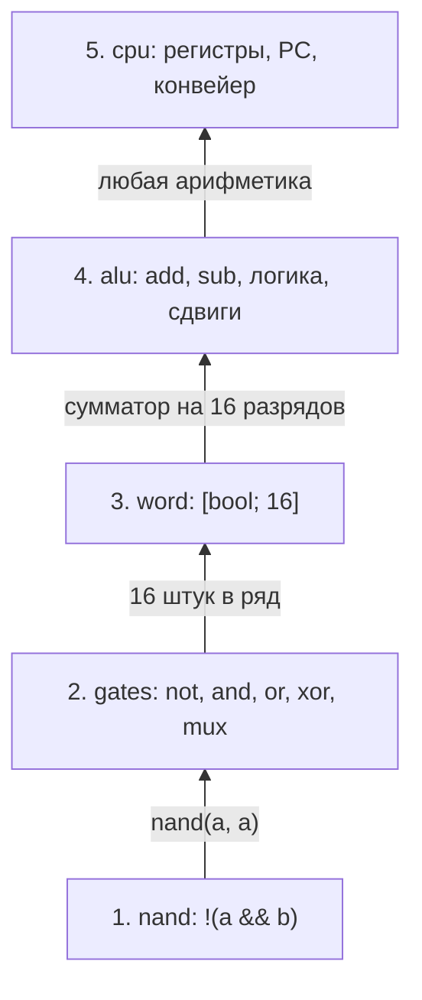

Всё выше слоя 1 строится из NAND:

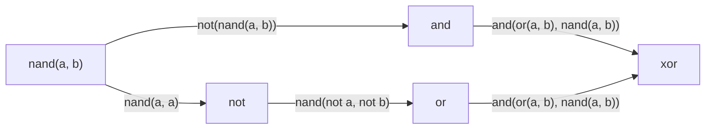

Один разряд сумматора (`full_adder`, на выходе пара «перенос, сумма»):

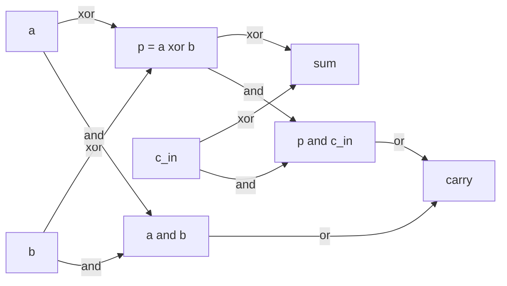

16 таких блоков подряд, перенос идёт по цепочке от младшего бита к старшему. Это `alu::add`.

## Чертёж №3. Карта памяти

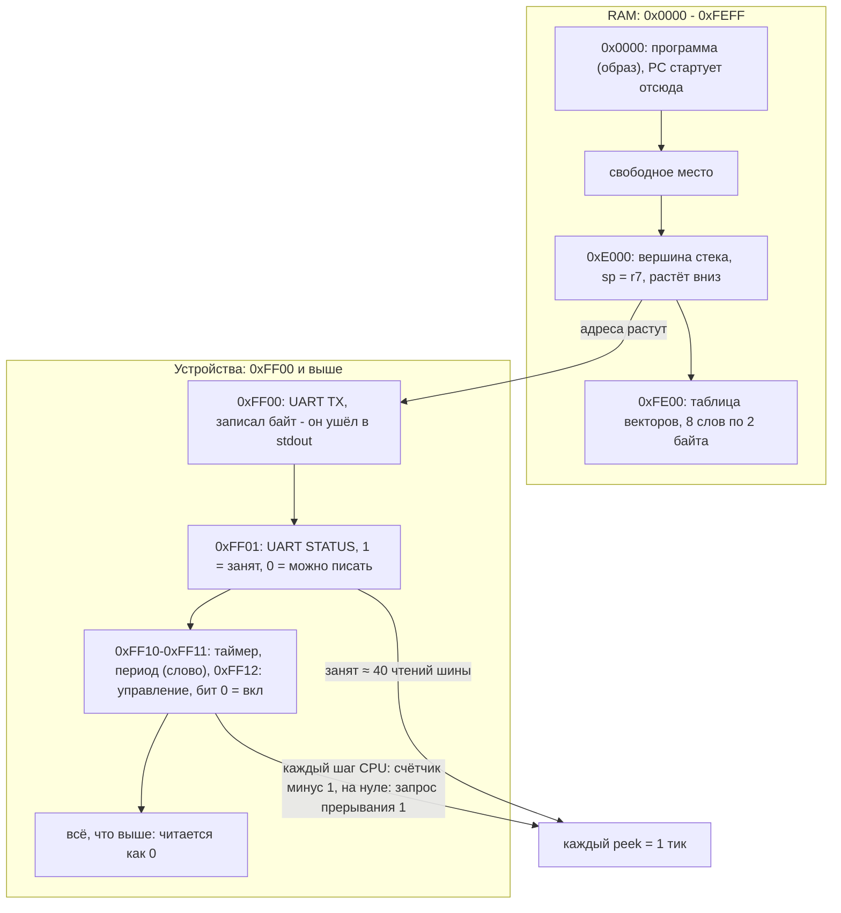

Время считается так: каждое чтение шины (`peek`) это один тик. Байт в UART занимает
передатчик на 40 тиков, программа ждёт в цикле `wait`.

## Чертёж №4. Формат инструкции (4 байта)

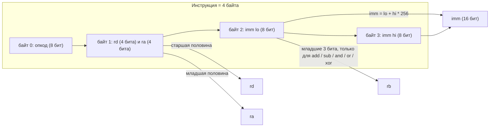

Регистры: `r0`…`r7`. `r7` это тоже `sp`.

## Чертёж №5. Конвейер (настоящий порядок стадий)

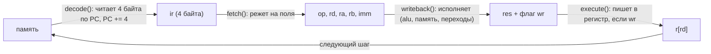

Названия стадий в коде перепутаны с тем, что они делают. Эта схема показывает правду.

Условный переход (`jz`, `jnz`):

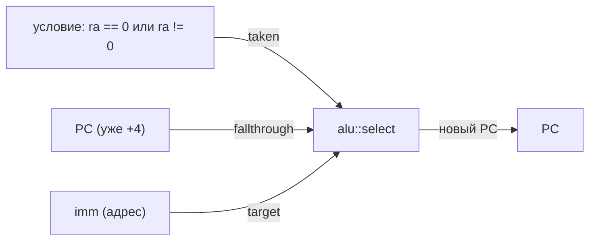

## Чертёж №6. Таблица инструкций

| код | мнемоника | формат | что делает |
|---|---|---|---|
| 0 | `nop` | — | ничего |
| 1 | `ldi rd, imm` | rd, imm | rd = imm |
| 2 | `mov rd, ra` | rd, ra | rd = ra |
| 3 | `add rd, ra, rb` | rd, ra, rb | rd = ra + rb |
| 4 | `sub rd, ra, rb` | rd, ra, rb | rd = ra − rb |
| 5 | `and rd, ra, rb` | rd, ra, rb | rd = ra & rb |
| 6 | `or rd, ra, rb` | rd, ra, rb | rd = ra \| rb |
| 7 | `xor rd, ra, rb` | rd, ra, rb | rd = ra ^ rb |
| 8 | `shl rd, ra, n` | rd, ra, imm | сдвиг влево на n (0–15) |
| 9 | `shr rd, ra, n` | rd, ra, imm | сдвиг вправо на n |
| 10 | `ldb rd, [ra+imm]` | rd, ra, imm | байт из памяти |
| 11 | `stb [ra+imm], rs` | rs, ra, imm | байт в память |
| 12 | `ld rd, [ra+imm]` | rd, ra, imm | слово (2 байта, младший первым) |
| 13 | `st [ra+imm], rs` | rs, ra, imm | слово в память |
| 14 | `jmp imm` | imm | PC = imm |
| 15 | `jz ra, imm` | ra, imm | если ra == 0, PC = imm |
| 16 | `jnz ra, imm` | ra, imm | если ra != 0, PC = imm |
| 17 | `call imm` | imm | push PC, PC = imm |
| 18 | `ret` | — | pop PC |
| 19 | `push rd` | rd | sp −= 2, [sp] = rd |
| 20 | `pop rd` | rd | rd = [sp], sp += 2 |
| 21 | `hlt` | — | стоп |
| 22 | `addi rd, ra, imm` | rd, ra, imm | rd = ra + imm |
| 23 | `cmp rd, ra` | rd, ra | флаги Z, N, C от rd − ra |
| 24 | `cmpi rd, imm` | rd, imm | флаги Z, N, C от rd − imm |
| 25 | `je imm` | imm | если Z, PC = imm |
| 26 | `jne imm` | imm | если не Z, PC = imm |
| 27 | `jlt imm` | imm | если не C (меньше, без знака), PC = imm |
| 28 | `jge imm` | imm | если C (больше или равно, без знака), PC = imm |
| 29 | `mul rd, ra, rb` | rd, ra, rb | rd = ra * rb (младшие 16 бит) |
| 30 | `div rd, ra, rb` | rd, ra, rb | rd = ra / rb, деление на 0: прерывание 0 |
| 31 | `mod rd, ra, rb` | rd, ra, rb | rd = ra % rb, деление на 0: прерывание 0 |
| 32 | `int n` | imm | программное прерывание n (0–7) |
| 33 | `iret` | — | pop флаги, pop PC |
| 34 | `sti` | — | разрешить прерывания |
| 35 | `cli` | — | запретить прерывания |

## Чертёж №7. Ассемблер

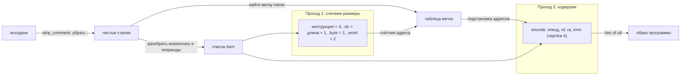

Директивы: `.str "текст\n"` (в конце добавляется нулевой байт), `.byte 1, 2, 3`, `.word 0x1234, метка`.
Escape-последовательности: `\n \r \t \e \0 \\ \"`.
Числа: `42`, `0xFF`, `'A'`, `-1`. Операнд памяти: `[r1]` или `[r1+4]`.

## Чертёж №8. Пузырь (бесполезные функции)

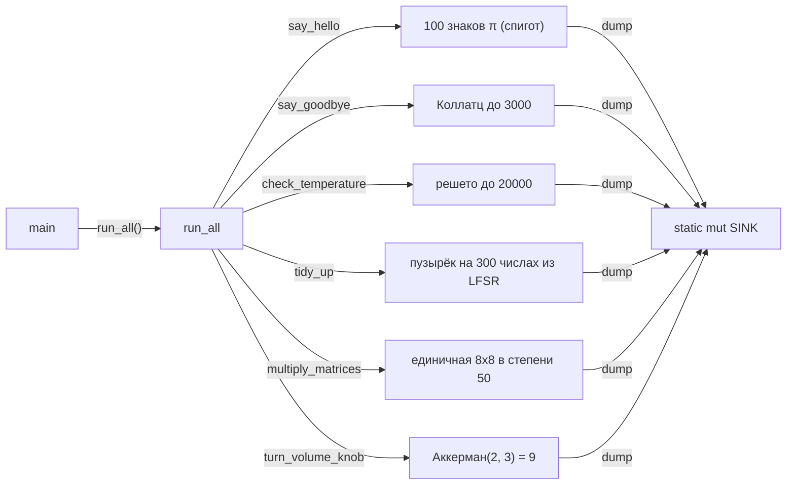

Они работают, но ничего не делают, кроме работы. Результат складывается в `SINK` (чтобы компилятор их
не выкинул) и нигде не используется. Проверка: `cargo test` (π сверяется с настоящими 100 знаками).

| функция | называется как | на самом деле |
|---|---|---|
| `say_hello` | здоровается | 100 знаков числа π (спигот) |
| `say_goodbye` | прощается | самая длинная цепочка Коллатца до 3000 |
| `check_temperature` | проверяет температуру | сколько простых ≤ 20000 (решето) |
| `tidy_up` | наводит порядок | пузырёк на 300 числах из LFSR |
| `multiply_matrices` | умножает матрицы | 50 раз умножает единичную 8×8 на единичную |
| `turn_volume_knob` | крутит громкость | Аккерман(2, 3) = 9 |
| `run_all` | запускает всё | зовёт все функции выше, вызывается из `main` |

## Чертёж №9. Прерывания и таймер

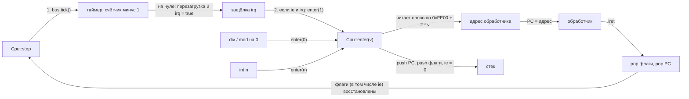

Если вектор равен нулю, процессор паникует: «нет обработчика прерывания».
Вектора: 0 деление на ноль, 1 таймер, 2–7 свободны для `int`.
Флаги в слове (младшие биты): Z, N, C, IE.

Сравнение: `cmp a, b` считает a + NOT b + 1. Перенос C = 1 означает «a больше или равно b» (без знака),
поэтому `jlt` прыгает, когда C = 0.

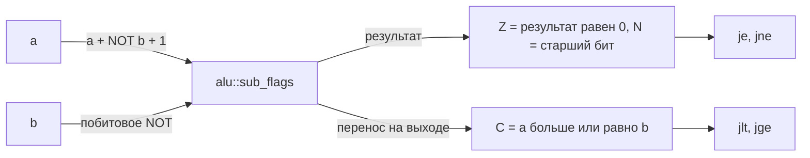

## Реестр лжи

Что в коде называется одним, а делает другое. Чертежи выше описывают то, что происходит на самом деле.

| где | что говорит | что делает |
|---|---|---|
| `alu::full_adder` | возвращает (сумма, перенос) | возвращает (перенос, сумма) |
| `alu::negate` | дополнительный код | побитовое NOT |
| `alu::complement` | побитовое NOT | дополнительный код (NOT + 1) |
| `alu::shl1` | сдвиг вправо | сдвиг влево |
| `alu::shr1` | сдвиг влево | сдвиг вправо |
| `gates::mux(sel, a, b)` | `a` при `sel = true` | `b` при `sel = true` |
| `Cpu::decode` | расшифровывает | читает память по PC |
| `Cpu::fetch` | тянет из памяти | режет поля |
| `Cpu::execute` | исполняет | пишет результат в регистр |
| `Cpu::writeback` | пишет результат | исполняет инструкцию |
| `Bus::peek` | ничего больше не делает | двигает часы и таймер UART |
| `Bus::load` | включает чипы | создаёт RAM |
| `Bus::reset` | кладёт или достаёт | копирует образ в RAM |
| `alu::sub_flags` | вычитает и ничего не запоминает | отдаёт результат и перенос (из него флаг C) |
| `alu::divmod` | возвращает (остаток, частное) | возвращает (частное, остаток) |
| `alu::mul` | умножает или складывает | складывает сдвинутые копии |
| `Bus::tick` | протирает пыль с шины | двигает таймер и ставит прерывание |
| `Cpu::set_cmp` | сравнивает | вычитает и выбрасывает результат, сохраняя флаги |
| `STI` (в `writeback`) | запрещает прерывания | разрешает |
| `CLI` (в `writeback`) | разрешает прерывания | запрещает |
